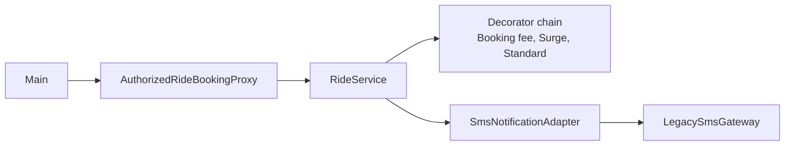
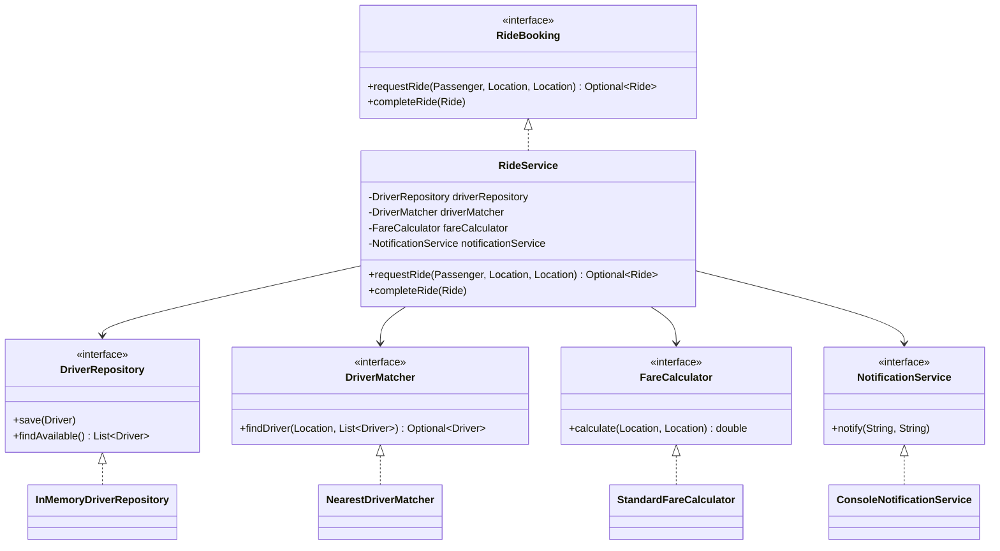
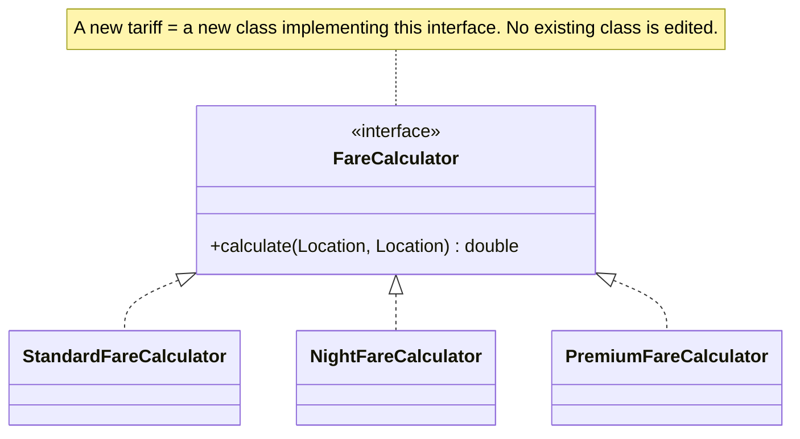
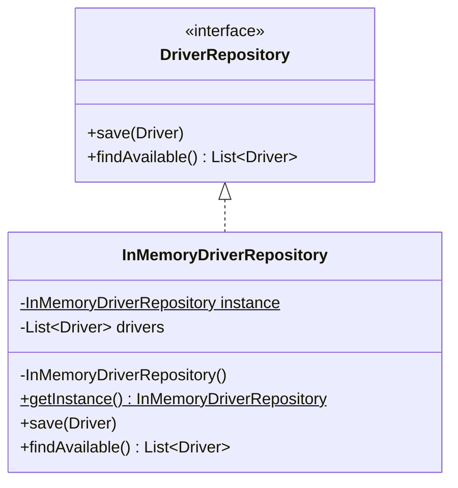
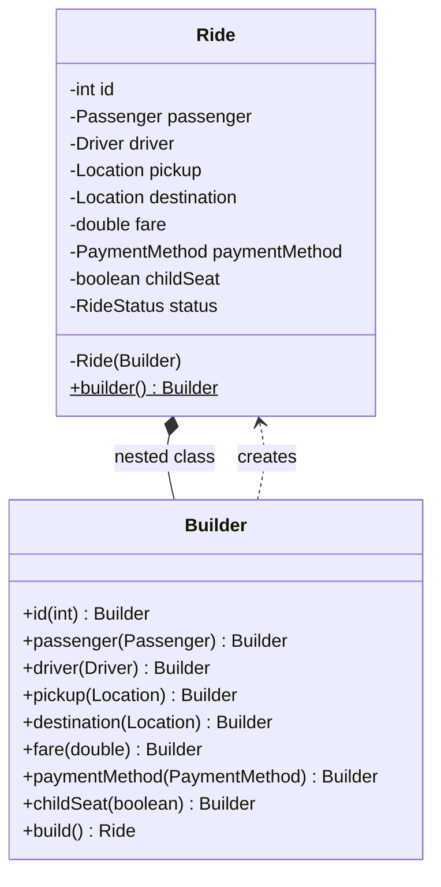
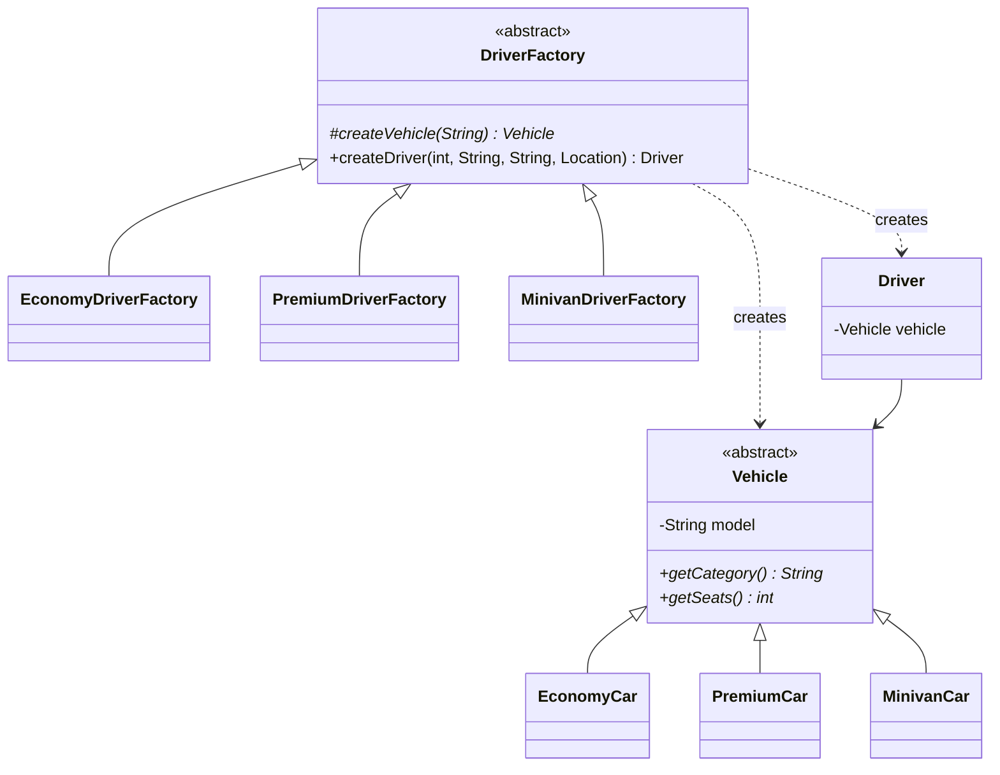
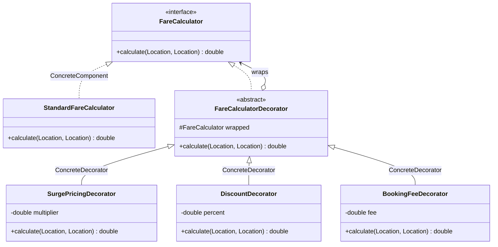
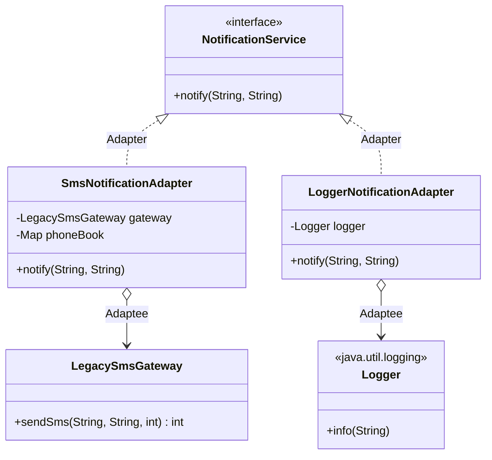
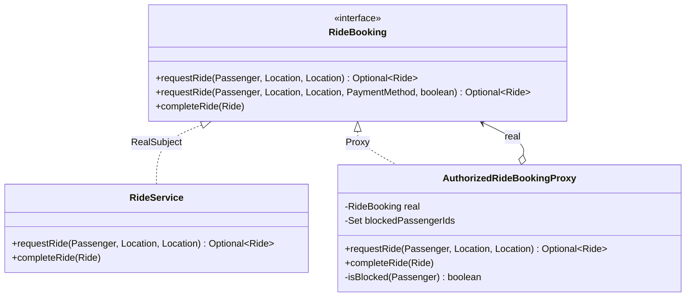

# Laboratory Work No. 3: Structural Design Patterns

**Subject:** Tehnici și Mecanisme de Proiectare Software (TMPS)
**Project:** Online Taxi Application
**Student:** Cuibari Vladislav | **Group:** FAF-243 | **Mentor:** asist. univ. Istrati Daniel

## 1. Domain description

An online taxi application. A passenger requests a ride, the system finds the nearest available driver, calculates the fare, creates a `Ride` and notifies the passenger and the driver. The project grows each lab:

| Lab | Topic | Added |
|---|---|---|
| 1 | SOLID principles | Single Responsibility, Open/Closed, Dependency Inversion |
| 2 | Creational patterns | Singleton, Builder, Factory Method |
| 3 | Structural patterns | Decorator, Adapter, Proxy |

## 2. Architecture

```
src/taxi/
├── client/         Main (demo)
├── domain/
│   ├── models/     Location, Passenger, Driver, Ride, RideStatus, PaymentMethod,
│   │               Vehicle, EconomyCar, PremiumCar, MinivanCar
│   └── factory/    DriverFactory + Economy / Premium / Minivan factories
├── patterns/
│   ├── decorator/  FareCalculatorDecorator, SurgePricing, Discount, BookingFee
│   ├── adapter/    SmsNotificationAdapter, LoggerNotificationAdapter
│   └── proxy/      AuthorizedRideBookingProxy
├── legacy/         LegacySmsGateway (third-party stand-in, never modified)
├── pricing/        FareCalculator + Standard / Night / Premium
├── notification/   NotificationService + ConsoleNotificationService
├── repository/     DriverRepository + InMemoryDriverRepository
├── matching/       DriverMatcher + NearestDriverMatcher
└── service/        RideBooking (interface), RideService
test/taxi/          PatternTests
```

**Execution path through all three structural patterns:**



## 3. SOLID principles (Lab 1)

### 3.1 Single Responsibility and Dependency Inversion

`RideService` only coordinates. Pricing, matching, storage and messaging each live in their own class, and `RideService` depends only on interfaces.



- **S:** each class has one reason to change. A new matching rule changes only the matcher.
- **D:** `RideService` never writes `new InMemoryDriverRepository()`. `Main` injects the implementations.

### 3.2 Open/Closed

New tariffs are added as new classes implementing `FareCalculator`. `RideService` and the existing calculators stay unchanged.



## 4. Creational patterns (Lab 2)

### 4.1 Singleton: `InMemoryDriverRepository`



One shared driver list, so every service sees the same availability. The constructor is private, and `getInstance()` creates the instance on first use. Clients still use it through the `DriverRepository` interface.

### 4.2 Builder: `Ride`



`Ride` has required and optional fields plus validation, so it is assembled step by step. The constructor is private, and `build()` validates the required fields.

### 4.3 Factory Method: `DriverFactory`



Roles: Creator = `DriverFactory`, Concrete Creators = the three factories, Product = `Vehicle`, Concrete Products = the three cars. Client code never writes `new EconomyCar(...)`.

## 5. Structural patterns (Lab 3)

### 5.1 Decorator: pricing rules

**Problem.** Fares depend on combinable rules (surge, discount, booking fee). One subclass per combination would explode in number. Decorators wrap a calculator and add one rule each, in any order, at runtime.



**Code** ([SurgePricingDecorator.java](src/taxi/patterns/decorator/SurgePricingDecorator.java))

```java
public class SurgePricingDecorator extends FareCalculatorDecorator {
    private final double multiplier;

    public SurgePricingDecorator(FareCalculator wrapped, double multiplier) {
        super(wrapped);
        if (multiplier < 1.0) {
            throw new IllegalArgumentException("Surge multiplier must be >= 1.0");
        }
        this.multiplier = multiplier;
    }

    @Override
    public double calculate(Location from, Location to) {
        return wrapped.calculate(from, to) * multiplier;
    }
}
```

The decorator calls the wrapped `FareCalculator` and adds its own rule. Because it implements the same interface, decorators stack in any order and `RideService` never knows how many layers exist.

**Tests**

| Test | What it checks |
|---|---|
| `decorator_stacked_gives_expected_result` | surge 1.5 then fee 10 on a base of 100 gives 160 |
| `decorator_order_changes_result` | the other order gives 165, proving runtime stacking |
| `decorator_rejects_invalid_multiplier` | a surge below 1.0 is rejected |

### 5.2 Adapter: legacy SMS gateway

**Problem.** The SMS gateway offers `sendSms(phone, text, priority)` and returns an error code. The application expects `NotificationService.notify(recipient, message)`. The gateway cannot be changed, so an adapter translates between the two.



**Code** ([SmsNotificationAdapter.java](src/taxi/patterns/adapter/SmsNotificationAdapter.java))

```java
@Override
public void notify(String recipient, String message) {
    String phone = phoneBook.getOrDefault(recipient, UNKNOWN_NUMBER);
    int code = gateway.sendSms(phone, message, NORMAL_PRIORITY);
    if (code != 0) {
        throw new IllegalStateException("SMS gateway error code " + code);
    }
}
```

The adapter translates the call (name to phone number, an extra priority argument) and the result (error code to exception), so the rest of the system sees only `NotificationService`. `LoggerNotificationAdapter` adapts a real JDK class (`java.util.logging.Logger`).

**Tests**

| Test | What it checks |
|---|---|
| `adapter_translates_call_to_legacy_gateway` | phone, text and priority reach the gateway correctly |
| `adapter_translates_error_code_to_exception` | a non-zero code becomes `IllegalStateException` |
| `adapter_uses_fallback_for_unknown_recipient` | an unknown name falls back to "unknown" |

### 5.3 Proxy: access control

**Problem.** Blocked passengers must not reach the booking logic. A protection proxy implements the same `RideBooking` interface as `RideService`, checks the passenger and either denies the call or delegates it unchanged.



**Code** ([AuthorizedRideBookingProxy.java](src/taxi/patterns/proxy/AuthorizedRideBookingProxy.java))

```java
@Override
public Optional<Ride> requestRide(Passenger passenger, Location pickup, Location destination) {
    if (isBlocked(passenger)) {
        return deny(passenger);
    }
    return real.requestRide(passenger, pickup, destination);
}
```

The check happens before delegation, and the interface is identical to the real service's, so clients cannot tell them apart.

**Tests**

| Test | What it checks |
|---|---|
| `proxy_blocks_unauthorized_passenger` | blocked passenger gets no ride and the real service is never called |
| `proxy_passes_authorized_call_unchanged` | authorized call reaches the real service and the same `Ride` comes back |
| `proxy_always_allows_completing_a_ride` | `completeRide` is always delegated |

## 6. Pattern interaction and demo output

One request passes through all three patterns (Proxy, then RideService with the Decorator chain, then the Adapter). The test `interaction_proxy_decorator_adapter_work_together` checks that the fare is (20 + 6 x 5) x 1.5 + 10 = 85 and that two SMS messages were sent.

Demo output (`java -cp out taxi.client.Main`):

```
=== 1. Authorized passenger: Proxy -> RideService -> Decorators + Adapter ===
[LEGACY SMS] to=+37360000001 priority=1 text=Driver Maria (Premium Mercedes E-Class (4 seats)) is on the way. Fare: 136,93 MDL
[LEGACY SMS] to=+37360000003 priority=1 text=New ride from Centru to Aeroport
Ride #1 | Centru -> Aeroport | driver: Maria | fare: 136,93 MDL | CASH | ACCEPTED
[LEGACY SMS] to=+37360000001 priority=1 text=Ride completed. Thank you!

=== 2. Blocked passenger: stopped by the Proxy ===
[ACCESS DENIED] Passenger Mallory is blocked.

=== 3. New decorator added at runtime, no existing class edited ===
[LEGACY SMS] to=+37360000001 priority=1 text=Driver Maria (Premium Mercedes E-Class (4 seats)) is on the way. Fare: 109,55 MDL
[LEGACY SMS] to=+37360000003 priority=1 text=New ride from Centru to Aeroport
Ride #1 | Centru -> Aeroport | driver: Maria | fare: 109,55 MDL | CASH | ACCEPTED
```

Check: distance Centru to Aeroport is 10.77, the standard fare is 20 + 6 x 10.77 = 84.62, with surge and fee 84.62 x 1.5 + 10 = 136.93, and with a 20% discount 109.55.

## 7. Unit tests

Run with one command:

```bash
javac -d out $(find src test -name "*.java") && java -cp out taxi.PatternTests
```

Result:

```
(paste the console output of PatternTests here, expected: 10 passed, 0 failed)
```


## 8. Justification and fit

| Pattern | Real problem in this project | Fit |
|---|---|---|
| Singleton | One shared driver list | Weakest. Dependency injection of a single object would also work |
| Builder | `Ride` has many fields, some optional, plus validation | Strong |
| Factory Method | Drivers get different vehicle types without client code naming concrete classes | Medium |
| Decorator | Fare rules combine freely and change often | Strong |
| Adapter | The SMS gateway has an incompatible interface and can't be changed | Strong |
| Proxy | Access control must sit in front of the service without changing it | Medium to strong |

## 9. Open for extension

| New requirement | New classes only |
|---|---|
| New pricing rule | a new `FareCalculatorDecorator` subclass |
| New notification channel | a new `NotificationService` implementation or adapter |
| New access rule or request logging | a new `RideBooking` proxy, stackable with the existing one |

## 10. Patterns studied but not implemented

| Pattern | Intent | Taxi example |
|---|---|---|
| Facade | One simple interface to a complex subsystem | `TaxiApp.bookTaxi(...)` hiding repository, matcher, pricing and notifications |
| Composite | Treat single objects and groups uniformly | A `Trip` made of several `Ride` legs, both with `getFare()` |
| Bridge | Separate abstraction from implementation | Notification kinds (ride, promo) x channels (SMS, email, push) |
| Flyweight | Share common state between many small objects | Thousands of rides referencing the same vehicle model objects |

## 11. Limitations

- `LegacySmsGateway` is a stand-in written for the demo. `LoggerNotificationAdapter` adapts a real JDK class.
- The proxy returns `Optional.empty()` both when access is denied and when no driver is available, so the caller cannot tell the cases apart.
- The phone-book lookup inside `SmsNotificationAdapter` is a small extra responsibility.
- Tests use a hand-written runner because no libraries are allowed.

## 12. Conclusions

(Write this in your own words: what was harder than expected and what you would design differently. For example: creating the `RideBooking` interface so the proxy shares the service's type, deciding where the phone-book lookup belongs, and how decorator order changes the result.)